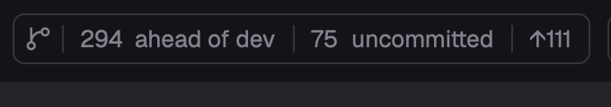

# pulls.review in Herdr

A Review bar for Herdr App's top bar and a review pane beside the agent: the bar counts what there is to review in the focused worktree (the branch's commits past the default branch, uncommitted files, commits to push and to pull), a click on a count reviews that diff, and the review draws natively in a pane, grouped and highlighted, from this fork's `jin.review` daemon. The pane's tab and header show its AI analysis with an agent's marks.

## What you see

- **Review bar** (`mods/pulls-review`, 26px tall, in a block of a 40px top bar): one 1px `border` outline, radius 6, its parts ruled apart by 1×14px `border` lines: a 14px `git-branch` icon (5px each side), then only the counts there are, 12px `dim` text with the number `font_medium`, 8px each side: `4 ahead of main` (`· merged?` once the upstream is gone), `3 uncommitted`, `↑2`, `↓1`. No fill at rest; a part hovered fills `hover` to the outline, its text and icon `foreground`. 8px after it, before what follows in the bar. Outside a git repository, or on another machine, nothing: its block is 0 wide.
- **Branch menu** (480px popup hanging from the bar under the click, at y 40): a search field, then `Commits` (7-character sha, subject, age) and `Branches vs main` (name, commits ahead), 32px rows.
- **Review pane** (`mods/review`, a pane split right of the agent, or a tab of its own): a 40px header (counts, a reviewed donut, Analyze, commits, fold and settings buttons), groups as tabs or a sidebar, from 1024px an aside with the group's files, and the diff, unified or split, with notes from the analysis.

## How it behaves

- The bar follows the focused pane (a review pane: the terminals in its tab). It reads git on a new location, on a change in the worktree, else every 10 s; switching back shows the last read at once. Nothing is fetched.
- A count's click opens that diff and starts its AI analysis (or follows the one running); the branch icon's menu picks a commit or a branch without analyzing. Enter in its search opens the first match.
- Where a review opens is `open` in `mods/pulls-review/config.json`: `herdr` (the pane), `pwa`, `browser` or `official` (the upstream CLI, one server per worktree kept by herdr-core).
- In the pane: `j`/`k` next and previous file, `r` reviewed, `f` whole file, `c` collapse, `s` unified or split. Analyze shows `Analyzing…` from the click; its tab and the pane header show a spinner while it runs, and if it ended while another tab was shown, a `done` dot or a `blocked` `!` until the tab is looked at. In the pane a failure stays on the button.

## Built from

- `mods/pulls-review/main.js`: one mod, three roles by `props()`: in a layout block the bar (`bar.js`); `{ menu: "review", … }` the branch menu; any other overlay (`mod.open`, or the bar's `{ cwd, args, analyze }`) opens a review (`open.js`) and closes itself (`frame: "none"`, 1×1).
- The bar sizes its own block: `on_size_change` on a `flex_none` wrapper reports its full width even when the block is narrower; divided by `settings().zoom` (it reports zoomed pixels), it goes to `run("layout.resize", { id: props().block, px })`, only when it changed.
- `herdr` mode: `pane.split { direction: "right", mod: "review", props: { root, page, n } }`, or `tab.new { mod: "review" }`; a pane already open gets the page through `shared("review")`.
- `mods/review/daemon.js` reads `~/.pulls.review/daemon.pid` and calls the daemon's `/api/review*` routes (`plans/fork/04-herdr-review-pane.md`), starting it with `jin.review -d --no-open --worktree`. The pane shares `review.titles`, `review.program` and `review.status` (per tab) for headers and tabs that read them, as Herdr T3's do.
- Programs: `git` (read-only, `--no-optional-locks -c core.fsmonitor=false`), `jin.review` or `pulls.review`, `hc` for `official`. Icons: Herdr's `mods/workspace-chrome/*`, Phosphor (`mods/review/ph`) and catppuccin file icons (`mods/review/cat`).

## Watch out

- `layout.resize` doesn't reach a block in a floating window's layout: there the bar keeps the block's size.
- The block's row needs `"resizable": false`: rows default to resizable, and a drag would fight the block sizing itself.
- A layout naming `pulls-review` without the folder installed reports `no mod folder` in `herdr-app status`.
- Herdr tells a mod pane neither its tab nor its folder: the pane claims the one review pane's tab no other has, and the bar takes a mod pane's folder from the terminals in its tab.
- The analysis start is fire-and-forget on the daemon: the pane shows running for up to 10 s before the first read sees the run.

## Done when

- `node mods/pulls-review/check.cjs` and `node mods/review/check-pane.cjs` print `ok`; `herdr-app check mods/pulls-review` and `mods/review` pass.
- In a repository with a branch past main, the bar shows `N ahead of main` and its block is exactly as wide as the bar plus 8px; in a folder that isn't a repository the block is 0 wide.
- Clicking a count opens the review pane beside the focused pane with that diff, and Analyze turns the pane's tab spinner on.
