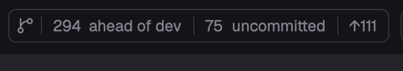

# pulls.review in Herdr App

English · [中文](README.zh-CN.md)

Two [Herdr App](https://herdr.dev) mods for this fork of [pulls.review](https://github.com/antfu/pulls.review): `pulls-review`, a Review bar for your top bar that reviews the focused worktree, and `review`, the pane the review draws in, beside the agent that wrote the change.



The Review bar shows only what there is: `4 ahead of main` (the branch's commits not on the default branch, with `· merged?` once its upstream is gone), `3 uncommitted` (uncommitted files), `↑2` (commits your upstream doesn't have), `↓1` (commits from your upstream). Click one to review just that diff. Click the logo to search and pick something else: a commit of this branch (on the default branch, a recent one), or another local branch against the default branch. The logo stays when there are no counts. With the review pane showing a diff, its count is lit, the logo's menu lists All changes and that diff's commits, and one commit shown adds its place with steps to the older and newer ones (`‹ Commit 3 of 54 ›`). It follows the focused pane; with the review pane focused, the repository it shows. The counts read your remote-tracking refs as they are: nothing is fetched for you.

Where a review opens is `open` in `mods/pulls-review/config.json`:

- `"herdr"` (the default): in a pane split off beside the agent (`mods/review/`; zoom it with Herdr's zoom key for more room), or, with Open in set to Tab in the pane's gear, in a tab of its own, named for what it reviews (`fix vs origin/main`). Another click in the same tab (with Tab, the same space) opens the new diff in that pane. It shows the groups (the AI analysis, else rule-based ones), each group's summary, its files with their notes and highlighted diffs, unified or split, a whole file around its hunks, one commit at a time (picked in the Review bar) and reviewed marks, shared with the browser. An analysis runs with the local agent picked when you press Analyze; as the app never starts one by itself, analyzing on open is off until you turn it on, and even then an analysis of an older version waits for Re-analyze. As in the app, the analysis's state is the Analyze button's: while it runs or once it fails, the button opens what it's doing or why it failed. The gear in the pane's header turns that on, picks the agent and its model (from its list or typed in) and the language the analysis writes in (the system's by default, as in the app; shared with the browser), and sets the view: unified or split, files as a tree or a list, groups as tabs or a sidebar, and where the next review opens: a pane or a tab. As in the app, from 1024px a column beside the diff holds the header and files of the group scrolled to, and the groups are tabs over the diff (one row, scrolling sideways when they don't fit) unless the sidebar is picked; narrower, there's no file column, the groups are always tabs, and the header with the tabs slides away after a long scroll down and comes back on any scroll up. A group's title and summary show only at the top of its diffs, scrolling away with them. The button left of the gear, as the app's, expands or collapses every file, or collapses the reviewed ones or the tests; marking a file reviewed collapses it and unmarking opens it again. Split falls back to unified where the diff is under 640px; narrower still, the header's text buttons turn to icons. Keys in the pane: `j`/`k` next and previous file, `r` reviewed, `f` whole file, `c` collapse, `s` unified or split. Needs the fork, `jin.review` 0.3.4-fork.2 or later.
- `"pwa"`: the fork's installed jin.review app (`jin.review -d --pwa`). Install the app first: run `jin.review -d` once, open the page in Chrome, install it as an app and allow it to open `web+pullsreview` links.
- `"browser"`: the fork in the browser (`jin.review -d`).
- `"official"`: the `pulls.review` CLI. Each worktree gets its own server, which herdr-core keeps running in the background (`hc ls --label pulls-review.root=<folder>`; stop one with `hc kill <address>`). The first open signs the browser in; later ones open a new tab on the same server.

With `"pwa"` or `"browser"`, a click on a count also starts the diff's AI analysis, or follows the one already running. A pick from the logo's menu doesn't. In `"herdr"` the pane's own setting decides, as above.

In `"herdr"` mode the pane's tab and header show its analysis with an agent's marks: a spinner while it runs; if it ended while you were on another tab, a dot when it finished or `!` when it failed, until you look. It isn't an agent, so it stays out of the agents list and Inbox.

## Install

1. Install one pulls.review CLI on Herdr's `PATH`: `bun add --global jin.review` for this fork (it installs next to `pulls.review`; one background server for every repo, stopped with `jin.review --stop`), or `bun add --global pulls.review` for `"official"`.
2. Ask your Herdr agent to add `herdr.dev/mods/JinJieBeWater/pulls.review`, or copy `mods/pulls-review/` and `mods/review/` into `~/.config/herdr-app/mods/`. They are a pair: the pane draws the review, the bar picks what it shows. Set `open` in `mods/pulls-review/config.json`.
3. Put the bar in your layout's top bar: a block in a `row` with `"resizable": false`, the block's own `id` in `props.block`. The bar sizes that block to itself, to nothing outside a repository:

   ```json
   { "id": "review", "type": "block", "size": { "px": 0 }, "window_drag": true,
  "content": { "mod": "pulls-review", "props": { "block": "review" } } }
   ```

   In [Herdr T3](https://github.com/JinJieBeWater/herdr-t3) it goes in the `tabs-row` row, right after `tabs`. `"herdr"` needs this block, the only place to switch the pane's diff or commit. `"mod.open:pulls-review"` in `keys.json` also reviews the focused worktree.
4. For the pane's analysis, pick a local agent once, with the gear in the pane's header or in the browser's review settings (`jin.review -d`): the daemon keeps that choice.

## What it runs

- Local folders only: a pane on another machine shows an error.
- Read-only git (`git status`, `git rev-parse`, `git symbolic-ref`, `git log`, `git for-each-ref`, `git rev-list`) and `pulls.review` or `jin.review`; the pane talks to the jin.review daemon on `127.0.0.1` with the session it keeps in `~/.pulls.review`, and starts it when it isn't running.

## Develop

`node mods/pulls-review/check.cjs` and `node mods/review/check-pane.cjs` run each mod without a window; `herdr-app check mods/<name>` loads it in Herdr. The fork's ESLint leaves `mods/` alone: they follow Herdr's mod style.
