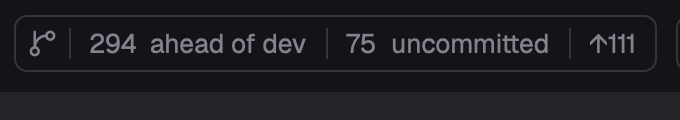

# 在 Herdr App 里用 pulls.review

[English](README.md) · 中文

这个 [pulls.review](https://github.com/antfu/pulls.review) fork 自带两个 [Herdr App](https://herdr.dev) mod：`pulls-review` 是放在顶栏里的 Review 栏，评审当前焦点所在的工作树；`review` 是评审显示的窗格，就在写这些改动的 agent 旁边。



Review 栏只显示有的内容：`4 ahead of main`（当前分支上默认分支没有的提交；上游分支已删除时附带 `· merged?`）、`3 uncommitted`（未提交的文件数）、`↑2`（上游还没有的提交）、`↓1`（上游新增的提交）。点击只看那一份 diff。点击 logo 可以搜索并选别的：当前分支的某个提交（在默认分支上是最近的提交），或者其他本地分支与默认分支的对比。没有计数时 logo 也会保留。它跟随当前焦点窗格；焦点在评审窗格上时，跟随同一标签页里的终端。这些计数读取现有的远程跟踪引用，不会替你 fetch。

评审在哪里打开，由 `mods/pulls-review/config.json` 里的 `open` 决定：

- `"herdr"`（默认）：在 agent 旁边分出一个窗格打开（`mods/review/`；需要更大空间时按 Herdr 的 zoom 键放大）；在齿轮里把 Open in 设为 Tab 时，改为单独开一个标签页，标签名写明在评审什么（`review · fix vs origin/main`）。在同一个标签页（Tab 模式下是同一个 space）再点一次，会在这个窗格里换成新的 diff。窗格里有：分组（有 AI 分析时用它，否则用规则分组）、每组的摘要、组内文件及其注释和带语法高亮的 diff（统一或分栏）、围绕改动显示整个文件、逐个 commit 查看，以及和浏览器共用的已看标记。点 Analyze 时用选好的本地 agent 分析；和网页端一样不会自己开始分析，打开时自动分析默认关闭，开启后遇到针对旧版本的分析也会等你点 Re-analyze。和网页端一样，分析状态显示在 Analyze 按钮上：分析中或失败时，点按钮查看进度或失败原因。窗格顶栏的齿轮里可以开启自动分析、选 agent 和模型（从列表里选或自己填）、选分析用的语言（默认跟随系统，和网页端一致，与浏览器共用），也可以设置视图：统一或分栏、文件用树状或列表、分组用标签或侧栏，以及下次评审在窗格还是标签页打开。和网页端一样：窗格宽于 1024px 时，diff 左边有一列，显示滚动到的分组的标题和文件，分组默认是 diff 上方的一排标签（只占一行，放不下时左右滚动），可在齿轮里换成侧栏；窄于 1024px 时没有文件列，分组固定为标签，并且向下连续滚动一段后顶栏和标签会收起，往上滚就回来。分组的标题和摘要只在 diff 顶部显示，往下滚就跟着消失。齿轮左边的按钮和网页端一样，可以一次展开或折叠全部文件，或只折叠已看文件、测试文件；标记已看会折叠该文件，取消标记会重新展开。diff 区窄于 640px 时分栏自动退回统一视图；再窄一些，顶栏的文字按钮变成图标。窗格快捷键：`j`/`k` 下一个、上一个文件，`r` 标记已看，`f` 整个文件，`c` 折叠，`s` 切换统一或分栏。需要 fork 的 `jin.review` 0.3.4-fork.2 或更新版本。
- `"pwa"`：在已安装的 jin.review 应用里打开（`jin.review -d --pwa`）。先安装应用：运行一次 `jin.review -d`，在 Chrome 打开该页面，安装为应用，并允许它打开 `web+pullsreview` 链接。
- `"browser"`：用 fork 在浏览器里打开（`jin.review -d`）。
- `"official"`：`pulls.review` CLI。每个工作树一个服务，由 herdr-core 在后台托管（`hc ls --label pulls-review.root=<目录>` 查看，`hc kill <address>` 停止）。第一次打开时浏览器完成登录，之后在同一个服务上打开新标签页。

用 fork 时（`"herdr"`、`"pwa"`、`"browser"`），点击计数还会开始这份 diff 的 AI 分析；已有分析在跑就直接接上。从 logo 菜单里选的不会。

`"herdr"` 模式下，窗格所在的标签和窗格标题栏用 agent 的标记显示分析状态：运行中转圈；如果结束时你在别的标签，完成显示圆点、失败显示 `!`，看过后消失。它不是 agent，所以不进 agents 列表和 Inbox。

## 安装

1. 在 Herdr 的 `PATH` 里装一种 pulls.review CLI：这个 fork 用 `bun add --global jin.review`（可与 `pulls.review` 同时安装；所有仓库共用一个后台服务，用 `jin.review --stop` 停止），`"official"` 用 `bun add --global pulls.review`。
2. 让你的 Herdr agent 添加 `herdr.dev/mods/JinJieBeWater/pulls.review`，或者把 `mods/pulls-review/`（用 `"herdr"` 时再加 `mods/review/`）复制进 `~/.config/herdr-app/mods/`，在 `mods/pulls-review/config.json` 里设置 `open`。
3. 把 Review 栏放进布局的顶栏：放在一个 `"resizable": false` 的 `row` 里，块自己的 `id` 写进 `props.block`。Review 栏会把这个块调整到自己的宽度，不在仓库里时缩到 0：

   ```json
   { "id": "review", "type": "block", "size": { "px": 0 }, "window_drag": true,
  "content": { "mod": "pulls-review", "props": { "block": "review" } } }
   ```

   在 [Herdr T3](https://github.com/JinJieBeWater/herdr-t3) 里，放进 `tabs-row` 这一行，紧跟在 `tabs` 后面。不放进布局时，在 `keys.json` 里绑定 `"mod.open:pulls-review"`，按键评审当前工作树。
4. 要在窗格里分析，先选一次本地 agent：用窗格顶栏的齿轮，或浏览器里的评审设置（`jin.review -d`），daemon 会记住这个选择。

## 会运行什么

- 只支持本机目录：窗格在其他机器上时会报错。
- 只读的 git（`git status`、`git rev-parse`、`git symbolic-ref`、`git log`、`git for-each-ref`、`git rev-list`）和 `pulls.review` 或 `jin.review`；评审窗格通过 `~/.pulls.review` 里保存的会话访问 `127.0.0.1` 上的 jin.review daemon，daemon 没在运行时会启动它。

## 开发

`node mods/pulls-review/check.cjs` 和 `node mods/review/check-pane.cjs` 不开窗口就能跑通各个 mod；`herdr-app check mods/<name>` 在 Herdr 里加载它。fork 的 ESLint 不检查 `mods/`，因为这里沿用 Herdr mod 的写法。
